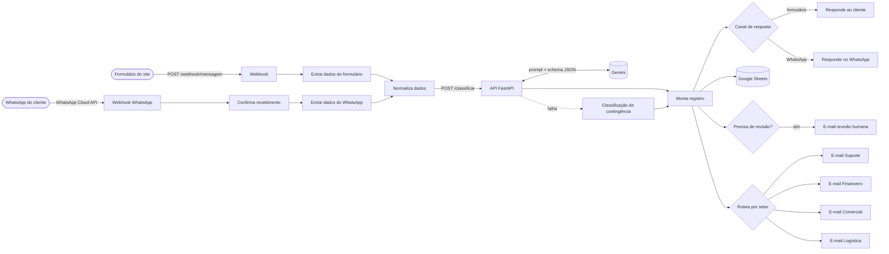

# Classificador de Mensagens de Clientes com IA

> Desafio Técnico KODIE: IA e Automação · Caso **4.1 — Classificação de Mensagens**

O cliente escreve pelo **formulário do site** ou pelo **WhatsApp**. Um fluxo no **n8n** recebe a mensagem e chama uma API em **FastAPI**, que usa o **Google Gemini** para devolver um **JSON validado** com categoria, setor, prioridade, sentimento, resumo e uma resposta. O fluxo então responde ao cliente pelo mesmo canal, registra tudo no **Google Sheets** e envia um **e-mail para o setor responsável**. Mensagens urgentes ou duvidosas também vão para **revisão humana**.



---

## 1. Apresentação da ideia

Em muitas empresas pequenas, uma pessoa lê cada mensagem que chega, descobre do que se trata e repassa manualmente para quem resolve. É um trabalho repetitivo, lento e sujeito a erro: uma cobrança indevida pode ficar horas na fila atrás de um elogio. E boa parte dessas mensagens chega pelo WhatsApp, em texto curto e informal, misturada com tudo o mais.

A ideia surgiu desse cenário do dia a dia: deixar a **IA fazer a triagem** (entender o assunto, a urgência e o humor do cliente) e a **automação fazer o encaminhamento**, sem ninguém copiar e colar nada. A pessoa do atendimento passa a cuidar só do que realmente precisa de atenção humana.

## 2. Problema escolhido

**Caso 4.1 — Classificação de Mensagens.** Uma empresa recebe dúvidas, reclamações, solicitações e elogios pelos mesmos canais e não tem um processo organizado para identificar o assunto de cada mensagem nem para quem ela deve ir.

Perguntas que guiaram a solução:

| Pergunta do desafio | Resposta no projeto |
|---|---|
| Como a IA ajuda a organizar? | O Gemini interpreta o texto livre, inclusive o informal do WhatsApp, e extrai informações estruturadas. |
| Que informações identificar? | `categoria`, `setor`, `prioridade`, `sentimento`, `resumo`, `resposta_sugerida`, `confianca`. |
| Como classificar? | Um prompt com regras claras para cada valor e exemplos (*few-shot*). |
| Como automatizar o encaminhamento? | O n8n responde ao cliente, registra na planilha, roteia por setor (Switch) e alerta a revisão humana. |
| Como garantir o formato da resposta? | Schema JSON obrigatório no Gemini, validação Pydantic, novas tentativas e *fallback*. |

## 3. Solução proposta

1. O cliente envia a mensagem pelo **formulário** (um `POST` com `nome`, `email` e `mensagem`) ou pelo **WhatsApp** (a Meta avisa o n8n a cada mensagem recebida).
2. O n8n extrai os mesmos campos nas duas entradas, normaliza e chama a **API** (`POST /classificar`).
3. A API valida a entrada e envia ao **Gemini** um **prompt estruturado** junto com um **schema JSON**: o modelo só pode responder com os campos e valores permitidos.
4. A API **valida de novo** a resposta com Pydantic. Se vier fora do formato ou o Gemini falhar, ela tenta de novo. Se nada der certo, devolve um *fallback* seguro (`setor: revisao_humana`).
5. A API decide se o caso precisa de **revisão humana** (prioridade urgente, confiança abaixo de 0,6 ou mensagem não classificada) e monta a **resposta ao cliente**.
6. O n8n, em paralelo:
   - responde ao cliente **pelo mesmo canal** (resposta do webhook ou mensagem no WhatsApp), com o número de protocolo;
   - grava uma linha na planilha **Atendimentos** (Google Sheets);
   - envia e-mail para o **setor responsável** (Suporte, Financeiro, Comercial ou Logística);
   - se necessário, envia um alerta de **revisão humana**.

**Nenhuma mensagem se perde.** Se a IA falhar, a API devolve o *fallback*. Se a própria API estiver fora do ar ou recusar a entrada, o n8n aplica uma **classificação de contingência**. Nos dois casos a mensagem é registrada, o cliente recebe a confirmação e uma pessoa é avisada.

**Onde a IA participa:** ela interpreta a linguagem natural (gírias, abreviações, erros de digitação, emojis), decide categoria, setor e prioridade, avalia o sentimento, resume a mensagem e redige uma resposta inicial.

**Onde a IA não decide sozinha:** a sugestão da IA só é enviada direto ao cliente quando o caso é simples. Em casos urgentes, duvidosos ou não classificados (um áudio, por exemplo), o cliente recebe apenas a confirmação de recebimento, e quem responde de verdade é uma pessoa.

### Exemplo de resposta da API

```json
{
  "categoria": "reclamacao",
  "setor": "financeiro",
  "prioridade": "urgente",
  "sentimento": "negativo",
  "resumo": "Cliente relata cobrança duplicada no boleto de outubro e pede estorno.",
  "resposta_sugerida": "Olá, Ana. Lamentamos o transtorno...",
  "confianca": 0.95,
  "canal": "formulario",
  "revisao_humana": true,
  "motivos_revisao": ["prioridade urgente"],
  "resposta_cliente": "Olá, Ana! Recebemos sua mensagem e um atendente vai falar com você em breve.",
  "origem": "gemini",
  "tentativas": 1,
  "erro_ia": null
}
```

## 4. Tecnologias utilizadas

| Camada | Tecnologia |
|---|---|
| IA | Google Gemini (SDK `google-genai`) com saída JSON estruturada (`response_schema`) |
| Back-end | Python 3.12 · FastAPI · Pydantic v2 · Uvicorn |
| Automação | n8n 2 (Webhook, Edit Fields, Code, HTTP Request, IF, Switch, Google Sheets, Gmail, Respond to Webhook) |
| Canais de entrada | Formulário/site (Webhook) · WhatsApp (WhatsApp Cloud API, da Meta) |
| Registro | Google Sheets |
| Notificação | Gmail |
| Testes | pytest · FastAPI TestClient (38 testes que não chamam o Gemini) · GitHub Actions |
| Infra (diferencial) | Docker · Docker Compose (API + n8n + túnel opcional para o WhatsApp) |

## 5. Funcionamento do sistema

### Como a API recebe os dados

`POST /classificar` com o corpo abaixo. O Pydantic valida automaticamente e devolve **422** com o detalhe do erro quando algo está errado.

```json
{
  "canal": "whatsapp",
  "nome": "Ivo Santos",
  "telefone": "5531988887777",
  "mensagem": "oi, paguei o boleto ontem no pix e ainda aparece em aberto, qual o problema??"
}
```

| Campo | Regra |
|---|---|
| `canal` | `formulario` (padrão) ou `whatsapp` |
| `nome` | de 1 a 100 caracteres |
| `email` | e-mail válido (opcional se houver telefone) |
| `telefone` | de 8 a 15 dígitos; aceita qualquer formatação e guarda só os dígitos (opcional se houver e-mail) |
| `mensagem` | de 1 a 4096 caracteres |

É obrigatório informar `email` ou `telefone`, para que a empresa tenha como responder. A documentação interativa (Swagger) fica em `http://localhost:8000/docs`.

### Como a IA processa as informações

- **Prompt estruturado** ([app/prompt.py](app/prompt.py)): define o papel ("assistente de triagem"), as regras de cada campo, os critérios de prioridade, o tom da resposta em cada canal e três exemplos.
- **Mensagem isolada:** o texto do cliente vai entre as tags `<mensagem>` e `</mensagem>`, e o prompt manda tratar esse conteúdo só como texto a classificar. Assim, um cliente que escreva "ignore as regras" não muda o comportamento da IA.
- **Schema JSON** (`GEMINI_SCHEMA`): obriga o Gemini a devolver apenas os campos e valores (`enum`) permitidos.
- **Validação dupla** ([app/ia.py](app/ia.py)): a resposta passa pelo modelo Pydantic `Classificacao`. Pequenas variações são corrigidas antes ("Dúvida" vira `duvida`, 95 vira 0,95).
- **Falhas tratadas:** limite de requisições (429) e sobrecarga (503) esperam e tentam de novo, com um modelo reserva na última tentativa. Modelo aposentado (404) é trocado pelo que o próprio Gemini indica. Se o modelo não aceitar prompt de sistema ou schema, a API reenvia de outro jeito. Chave inválida não é repetida.
- **Fallback:** se nada funcionar, a API responde `origem: "fallback"`, manda para revisão humana e explica o motivo em `erro_ia`.
- **Modo simulado** (`IA_MODO=simulado`): um classificador por regras ([app/simulador.py](app/simulador.py)) devolve o mesmo contrato, para testar o fluxo sem chave. Não substitui a IA.

### Como a automação é executada

| # | Node n8n | Tipo | Função |
|---|---|---|---|
| 1 | Webhook | Webhook | Recebe `POST /webhook/mensagem` (formulário) e espera a resposta do node 11. |
| 2 | Extrai dados do formulário | Edit Fields | Pega `nome`, `email`, `telefone` e `mensagem` do corpo e marca `canal = formulario`. |
| 3 | WhatsApp - Recebe mensagem | Webhook | Recebe `POST /webhook/whatsapp`, chamado pela Meta a cada mensagem. |
| 4 | WhatsApp - Confirma recebimento | Respond to Webhook | Responde 200 à Meta na hora, antes de processar, para ela não reenviar a mensagem. |
| 5 | Extrai dados do WhatsApp | Code | Lê o formato da Meta: nome do perfil, telefone e texto. Mídia sem texto vira `[audio]`, `[image]` etc. Avisos de "entregue" e "lida" são ignorados. |
| 6 | Normaliza dados | Edit Fields | Gera `id` e `recebido_em`, limpa espaços, deixa o telefone só com dígitos. |
| 7 | Classificar com IA (API) | HTTP Request | `POST http://api:8000/classificar`. Em caso de erro, tenta de novo e depois segue pela saída de erro. |
| 8 | Classificação de contingência | Edit Fields | Só roda se a API não responder ou recusar a entrada: marca a mensagem para revisão humana. |
| 9 | Monta registro | Edit Fields | Junta os dados do cliente com a classificação e monta a mensagem com o protocolo. |
| 10 | Canal de resposta | Switch | Escolhe por onde responder: formulário ou WhatsApp. |
| 11 | Responde ao cliente | Respond to Webhook | Devolve protocolo, setor e mensagem para quem chamou o formulário. |
| 12 | WhatsApp - Responde ao cliente | HTTP Request | Envia a mensagem pela API da Meta. Se falhar, o fluxo continua. |
| 13 | Registra na planilha | Google Sheets | Acrescenta uma linha na aba **Atendimentos**. |
| 14 | Precisa de revisão? | IF | `revisao_humana == true`. |
| 15 | E-mail Revisão humana | Gmail | Alerta a supervisão com os motivos. |
| 16 | Roteia por setor | Switch | Uma saída para cada setor. |
| 17–20 | E-mail Suporte / Financeiro / Comercial / Logística | Gmail | Envia a mensagem classificada ao setor. |
| 21 | WhatsApp - Verificação (GET) | Webhook | Recebe a chamada única que a Meta faz ao cadastrar o webhook. |
| 22 | WhatsApp - Responde verificação | Respond to Webhook | Devolve o desafio se o token conferir; senão, 403. |

O fluxo está em [n8n/workflow.json](n8n/workflow.json) e já vem com notas explicando cada bloco.

## 6. Como executar

### Pré-requisitos

- Uma chave da API do Gemini: <https://aistudio.google.com/apikey>
- **Opção A:** Docker Desktop (recomendado). **Opção B:** Python 3.12+ e Node.js 24+.
- Uma conta Google para o Sheets e o Gmail.
- Para o WhatsApp real (opcional): uma conta em <https://developers.facebook.com>.

### 6.1 Configurar o `.env`

```bash
cp .env.example .env      # no Windows: copy .env.example .env
# edite o .env e coloque sua GEMINI_API_KEY
```

### 6.2 Opção A: Docker Compose (API + n8n)

```bash
docker compose up -d --build
```

- API: <http://localhost:8000/docs>
- n8n: <http://localhost:5678>

Importe o fluxo pela interface do n8n (*Workflows → Import from File → `n8n/workflow.json`*) ou pela linha de comando:

```bash
docker compose exec n8n n8n import:workflow --input=/workflows/workflow.json
```

### 6.3 Opção B: sem Docker

```bash
python -m venv .venv
.venv\Scripts\activate            # Linux/Mac: source .venv/bin/activate
pip install -r requirements-dev.txt
uvicorn app.main:app --port 8000
```

Em outro terminal, suba o n8n e importe o `n8n/workflow.json`:

```bash
npx n8n
```

Sem Docker, faça dois ajustes:

- No node **Classificar com IA (API)**, troque a URL de `http://api:8000/classificar` para `http://127.0.0.1:8000/classificar`.
- Para o WhatsApp, defina as variáveis `N8N_BLOCK_ENV_ACCESS_IN_NODE=false` e `WHATSAPP_VERIFY_TOKEN` no terminal antes de rodar `npx n8n`.

O próprio n8n avisa que rodar fora de container está em desuso, então o Docker é o caminho recomendado.

### 6.4 Configurar o n8n

1. **Planilha:** crie uma planilha no Google Sheets com uma aba chamada `Atendimentos` e, na primeira linha, os cabeçalhos:
   `ID | Recebido em | Canal | Nome | Contato | Mensagem | Categoria | Setor | Prioridade | Sentimento | Confiança | Resumo | Resposta sugerida | Revisão? | Origem IA`
2. **Credenciais Google:** no n8n, crie as credenciais *Google Sheets OAuth2* e *Gmail OAuth2* (guia oficial: <https://docs.n8n.io/integrations/builtin/credentials/google/>). Em instalação local, a URL de redirecionamento é `http://localhost:5678/rest/oauth2-credential/callback`.
3. No node **Registra na planilha**, cole a URL da sua planilha e selecione a credencial.
4. Nos nodes de **e-mail**, selecione a credencial e troque `SEU_EMAIL+setor@gmail.com` pelos endereços reais. Para a demonstração, use apelidos do seu próprio Gmail (ex.: `voce+financeiro@gmail.com`): tudo chega na sua caixa.
5. **Publique** (ative) o workflow. O n8n 2 só publica quando todos os nodes ativos têm credencial e parâmetros válidos. Se quiser rodar antes de ter as credenciais do Google, **desative** o node **Registra na planilha** e os cinco nodes de e-mail: o fluxo funciona do mesmo jeito, só sem gravar na planilha nem enviar e-mail.
6. O node **WhatsApp - Responde ao cliente** não impede a publicação. Sem credencial, o envio falha, o node continua e o resto do fluxo segue. A credencial só é necessária para o WhatsApp real (seção 6.5).
7. Depois de testar, exporte o fluxo pelo n8n (menu **⋯ → Download**) e substitua o `n8n/workflow.json`. A exportação não leva senhas nem tokens, só o nome das credenciais.

### 6.5 WhatsApp

**Sem conta na Meta (simulação).** O script abaixo envia ao n8n o mesmo formato de aviso que a Meta envia. Dá para testar e tirar os prints do ramo do WhatsApp sem configurar nada na Meta. Só o envio da resposta ao cliente falha, o que é esperado.

```bash
python exemplos/simular_whatsapp.py
python exemplos/simular_whatsapp.py --texto "cadê meu pedido?" --nome "Ivo" --telefone 5531988887777
```

**Com mensagens reais.** O fluxo usa a **WhatsApp Cloud API**, a API oficial da Meta, que oferece um número de teste gratuito. Guia oficial: <https://developers.facebook.com/docs/whatsapp/cloud-api/get-started>.

1. Em <https://developers.facebook.com/apps>, crie um app e adicione o produto **WhatsApp**.
2. Na tela de configuração da API do WhatsApp, copie o **token de acesso** e cadastre o seu celular como destinatário do número de teste.
3. No n8n, crie a credencial **WhatsApp API** com esse token e o ID da conta do WhatsApp Business, e selecione-a no node **WhatsApp - Responde ao cliente**.
4. No `.env`, defina `WHATSAPP_VERIFY_TOKEN` com um texto inventado por você. A Meta só entrega mensagens em um endereço público com HTTPS, então suba também o túnel:

   ```bash
   docker compose --profile whatsapp up -d
   docker compose logs tunel        # mostra um endereço https://....trycloudflare.com
   ```

5. Com o workflow **publicado**, cadastre o webhook no painel da Meta (WhatsApp → Configuração):
   - **URL de retorno:** `https://SEU-ENDERECO.trycloudflare.com/webhook/whatsapp`
   - **Token de verificação:** o mesmo valor de `WHATSAPP_VERIFY_TOKEN`
   - Depois de verificar, assine o campo **messages**.
6. Mande uma mensagem do seu celular para o número de teste. O fluxo roda e você recebe a confirmação com o protocolo.

Observações:

- O token temporário da Meta expira em cerca de 24 horas. Gere outro ou crie um token permanente de usuário do sistema.
- O endereço do túnel muda a cada reinício. Atualize a URL de retorno no painel da Meta quando isso acontecer.
- Enquanto o túnel está no ar, o n8n fica acessível pela internet. Use uma senha forte e desligue depois: `docker compose --profile whatsapp down`.
- Para usar outro provedor de WhatsApp, só dois nodes mudam: **Extrai dados do WhatsApp** (formato de entrada) e **WhatsApp - Responde ao cliente** (envio).

### 6.6 Testar

```bash
# formulário: dispara as 8 mensagens de exemplo no webhook do n8n
python exemplos/enviar_exemplos.py

# WhatsApp: dispara as 5 mensagens de exemplo no formato da Meta
python exemplos/simular_whatsapp.py

# direto na API, com os exemplos dos dois canais
python exemplos/enviar_exemplos.py --url http://localhost:8000/classificar --todos

# testes automatizados (não chamam o Gemini)
pytest -v
```

Ou manualmente:

```bash
curl -X POST http://localhost:5678/webhook/mensagem \
  -H "Content-Type: application/json" \
  -d '{"nome":"Ana Souza","email":"ana@cliente.demo","mensagem":"Fui cobrada duas vezes no boleto!"}'

curl -X POST http://localhost:5678/webhook/whatsapp \
  -H "Content-Type: application/json" \
  -d @exemplos/whatsapp_payload.json
```

Os scripts esperam 7 segundos entre um envio e outro, para respeitar o limite por minuto do plano gratuito do Gemini. Com `IA_MODO=simulado`, use `--pausa 0`.

### 6.7 Se tudo cair em "revisão humana"

Quando a IA falha, a API não quebra o fluxo: devolve `origem: "fallback"` e o motivo em `erro_ia`. Os casos mais comuns:

| O que aparece | Causa | Solução |
|---|---|---|
| `erro_ia` com `API key not valid`, `400` ou `403` | Chave errada ou sem permissão | Gere outra chave em <https://aistudio.google.com/apikey> |
| `erro_ia` com `404` ou `no longer available` | O modelo em `GEMINI_MODEL` foi aposentado ou não está liberado para a sua chave | A API já troca sozinha pelo modelo que o Gemini indica (veja o aviso no log). Para fixar, atualize `GEMINI_MODEL` no `.env`; o comando abaixo lista os modelos disponíveis |
| `erro_ia` com `Developer instruction is not enabled` | O modelo não aceita prompt de sistema separado | A API reenvia sozinha com o prompt junto da mensagem. O mesmo vale se o modelo recusar o schema JSON: o formato continua garantido pela validação |
| `erro_ia` com `503` ou `high demand` | O modelo está sobrecarregado no momento (temporário, comum no plano gratuito) | A API espera 5 s e 10 s e, na última tentativa, usa um modelo reserva (`GEMINI_MODEL_RESERVA` ou outro "flash" da chave) |
| `erro_ia` com `429` ou `RESOURCE_EXHAUSTED` | Limite de requisições do plano gratuito | A API já espera e tenta de novo; envie as mensagens com intervalo |
| `origem: "contingencia"` | A API não respondeu ou recusou a entrada (falta de contato, por exemplo) | Confira se a API está no ar (`/health`) e leia o erro na saída do node **Classificar com IA (API)** |

```bash
# lista os modelos liberados para a sua chave
curl -H "x-goog-api-key: SUA_CHAVE" "https://generativelanguage.googleapis.com/v1beta/models?pageSize=200"
```

Na demo ([demo/index.html](demo/index.html)), o botão **Testar chave e listar modelos** faz essa verificação e troca o modelo automaticamente.

---

## 7. Documentação do fluxo de automação (prints)

As capturas ficam em [docs/prints/](docs/prints/), com os nomes listados em [docs/prints/README.md](docs/prints/README.md).

### 7.1 Fluxo completo

*Todos os nodes conectados: as duas entradas (formulário e WhatsApp), a classificação pela API e os quatro ramos paralelos (resposta ao cliente, planilha, revisão e roteamento por setor).*

### 7.2 Execuções bem-sucedidas
| Entrada | Print |
|---|---|
| Mensagem do formulário |  |
| Mensagem do WhatsApp |  |

### 7.3 Configuração dos nodes
| Node | Print | O que mostra |
|---|---|---|
| Webhook |  | Método POST, caminho `mensagem` e resposta pelo node *Respond to Webhook*. |
| Extrai dados do formulário |  | Campos tirados do corpo da requisição e `canal = formulario`. |
| WhatsApp - Recebe mensagem |  | Método POST, caminho `whatsapp` e a entrada no formato da Meta. |
| WhatsApp - Confirma recebimento |  | Resposta imediata à Meta. |
| Extrai dados do WhatsApp |  | Código que lê o formato da Meta e ignora avisos sem mensagem. |
| Normaliza dados |  | Expressões que geram `id` e `recebido_em` e limpam os campos. |
| Classificar com IA (API) |  | URL da API, corpo JSON, timeout e a saída com o JSON da IA. |
| Classificação de contingência |  | Campos usados quando a API não responde. |
| Monta registro |  | União dos dados do cliente com a classificação e a mensagem com protocolo. |
| Canal de resposta |  | Regras que escolhem formulário ou WhatsApp. |
| Responde ao cliente |  | JSON devolvido para quem chamou o webhook. |
| WhatsApp - Responde ao cliente |  | Chamada à API da Meta, credencial e corpo da mensagem. |
| Registra na planilha |  | Operação *Append*, aba `Atendimentos` e mapeamento das colunas. |
| Precisa de revisão? |  | Condição `revisao_humana == true`. |
| Roteia por setor |  | Uma regra para cada setor. |
| E-mail (setor) |  | Destinatário, assunto e corpo com expressões. |
| WhatsApp - Verificação |  | Conferência do token e devolução do desafio da Meta. |

### 7.4 Resultados
| Etapa | Print |
|---|---|
| Saída da API (JSON da IA) |  |
| Planilha preenchida |  |
| E-mails recebidos por setor |  |
| Conversa no WhatsApp |  |

---

## Demonstração visual (sem instalar nada)

[demo/index.html](demo/index.html) é uma página única que **simula** o fluxo completo no navegador, nos dois canais: os nodes acendem um a um, mostram configuração, entrada e saída, e a planilha, os e-mails e a conversa do WhatsApp se preenchem. Ela tem um modo com regras locais e um modo que chama o Gemini de verdade (a chave fica só na memória da aba). Serve para apresentar a ideia; a prova de funcionamento são os prints do n8n real acima.

## Estrutura do projeto

```
├── app/
│   ├── main.py          # rotas FastAPI (/health, /classificar)
│   ├── ia.py            # chamada ao Gemini, validação, novas tentativas e fallback
│   ├── prompt.py        # prompt estruturado + schema JSON
│   ├── schemas.py       # modelos Pydantic de entrada e saída
│   ├── simulador.py     # classificador por regras (IA_MODO=simulado)
│   └── config.py        # variáveis de ambiente
├── tests/test_api.py    # 38 testes, sem chamar o Gemini
├── n8n/workflow.json    # fluxo do n8n (22 nodes)
├── exemplos/
│   ├── mensagens.json          # 13 mensagens de teste (formulário e WhatsApp)
│   ├── enviar_exemplos.py      # dispara os exemplos do formulário
│   ├── simular_whatsapp.py     # dispara os exemplos do WhatsApp no formato da Meta
│   └── whatsapp_payload.json   # um aviso da Meta, para testar com curl
├── demo/index.html      # demonstração visual no navegador
├── docs/prints/         # capturas do n8n
├── .github/workflows/   # testes automáticos a cada push
├── Dockerfile
├── docker-compose.yml
├── .env.example
└── requirements.txt
```

## Segurança

- Nenhuma chave está no repositório: use o `.env` (ignorado pelo Git) a partir do `.env.example`.
- As credenciais do Google e o token do WhatsApp ficam guardados apenas dentro do n8n. O token de verificação do webhook vem de uma variável de ambiente, então não aparece no fluxo exportado nem nos prints.
- A API valida toda a entrada e nunca devolve erro da IA para o n8n: no pior caso, a mensagem vai para revisão humana.
- O texto do cliente é isolado no prompt, para não ser tratado como instrução.

## Limitações conhecidas

- O fluxo não confere a assinatura `X-Hub-Signature-256` que a Meta envia. Em produção, essa conferência deve ser feita antes de aceitar a mensagem.
- A Meta pode entregar a mesma mensagem mais de uma vez. O fluxo não remove duplicatas (o campo `wa_message_id` permite fazer isso).
- Áudios, imagens e figurinhas não são interpretados: vão para revisão humana.
- Um formulário com dados inválidos (sem contato, por exemplo) não recebe erro de volta: a mensagem é registrada e vai para revisão humana.
- O WhatsApp só permite mensagem livre até 24 horas depois da última mensagem do cliente. A resposta automática sempre sai dentro desse prazo; respostas posteriores do atendente podem precisar de um modelo aprovado.
- A planilha guarda nome e contato dos clientes. O acesso a ela deve ser restrito à equipe de atendimento.
